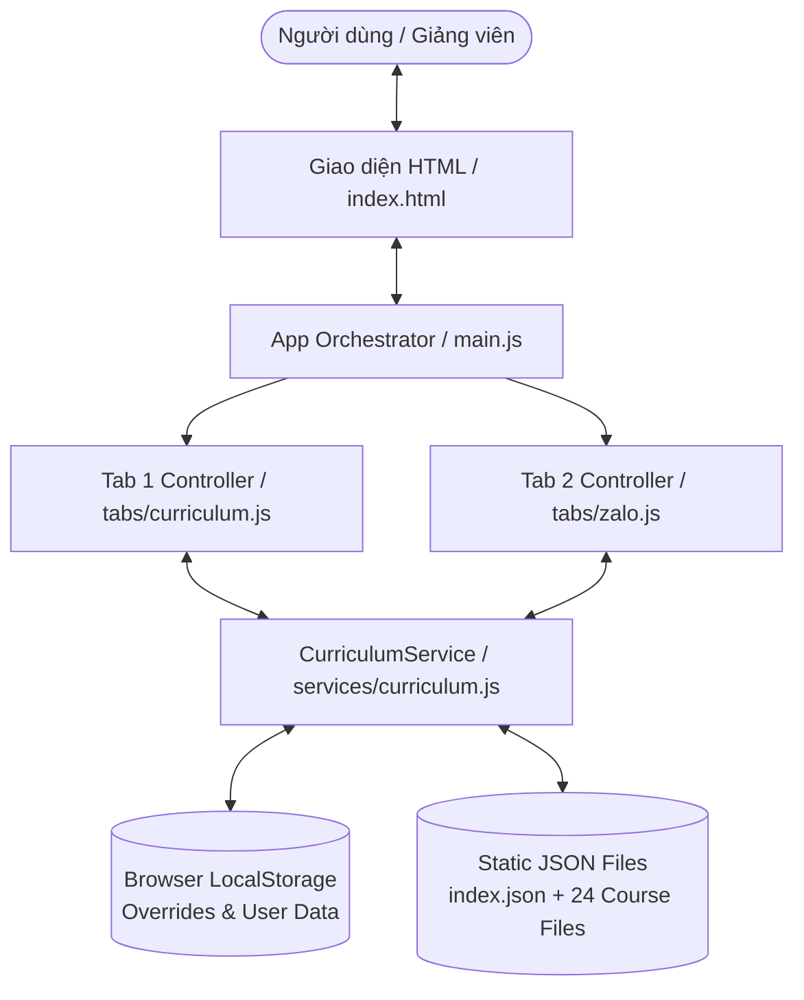

# TÀI LIỆU ĐẶC TẢ KỸ THUẬT & BẢN THIẾT KẾ CHUYỂN ĐỔI HỆ THỐNG
# (PROJECT TECHNICAL SPECIFICATION & MIGRATION BLUEPRINT)

> **Dự án:** MindX Teacher Assistant — Web Edition  
> **Phiên bản hiện tại:** v2.0 (Curriculum & Zalo Reporting)  
> **Mục tiêu tài liệu:** Cung cấp đặc tả kỹ thuật chi tiết 100% để tái hiện/chuyển đổi toàn bộ ứng dụng sang ngôn ngữ hoặc tech stack mới (Flutter, Next.js/React, Vue 3, Electron, Tauri, Go/Wasm, Python/PyQt...) mà không làm thất thoát bất kỳ nghiệp vụ, dữ liệu hoặc trải nghiệm UI/UX nào.

---

## 1. TỔNG QUAN DỰ ÁN & TECH STACK HIỆN TẠI

### 1.1. Mục đích dự án & Đối tượng người dùng
* **Bài toán giải quyết:**
  1. **Tra cứu & Quản lý Giáo trình:** Giảng viên/Trợ giảng MindX cần tra cứu nhanh nội dung bài giảng, linh kiện cơ khí, câu lệnh lập trình, mục tiêu học tập (Kiến thức - Kỹ năng - Thái độ - LOs), link slide bài giảng, link tài liệu ôn tập và sách học viên (StudentBook) cho **24 khóa học** thuộc 2 khối **Robotics (VEX GO, VEX IQ)** và **Coding - C4K (Scratch, GameMaker, Python, Web/JS, Computer Science)**.
  2. **Tự động hóa Báo bài Zalo:** Tự động sinh nội dung báo bài sau buổi học gửi cho Phụ huynh học sinh qua Zalo với cấu trúc chuẩn hóa, định dạng Rich Text có màu sắc nổi bật, bố cục rõ ràng, kèm phân nhánh quản lý Bài tập về nhà (BTVN) trên hệ thống Denise và số trang StudentBook dành riêng cho khối Coding.
  3. **Cá nhân hóa cục bộ:** Cho phép giảng viên tùy biến và lưu trữ tạm thời/lâu dài các liên kết Slide, tài liệu ôn tập, số trang BTVN, tên giáo viên, mã lớp trên máy cá nhân mà không cần backend/server phức tạp.
* **Đối tượng người dùng:** Giảng viên (Teacher), Trợ giảng (Teaching Assistant - TA), Quản lý học vụ (Academic Officer) tại Hệ thống Công nghệ & Khởi nghiệp Sáng tạo Trẻ MindX.

### 1.2. Ngôn ngữ lập trình & Công nghệ hiện tại
* **Kiến trúc:** Client-side Single Page Application (SPA), zero-backend runtime.
* **Ngôn ngữ:**
  - **HTML5:** Cấu trúc ngữ nghĩa (Semantic HTML) với các thẻ `<aside>`, `<main>`, `<header>`, `<section>`, form controls và thuộc tính `contenteditable="true"`.
  - **CSS3:** Sử dụng CSS Variables (Custom Properties), Flexbox, CSS Grid 2 cột Master-Detail, responsive media queries, hiệu ứng chuyển động mượt mà.
  - **JavaScript:** ES6+ Native Modules (`import`/`export`), `async/await`, Fetch API, Clipboard API (`navigator.clipboard.write` với `ClipboardItem`), LocalStorage API, Regex parsing.
* **Mô hình module hóa:** Tách biệt rõ ràng thành ES Modules theo chức năng:
  - `main.js`: Bộ điều phối vòng đời (Lifecycle & Tab Routing Orchestrator).
  - `services/curriculum.js`: Service layer quản lý nạp dữ liệu, cache bộ nhớ, merge overrides từ `localStorage`.
  - `tabs/curriculum.js`: Presentation & UI Controller cho Tab 1 (Kho Giáo trình).
  - `tabs/zalo.js`: Presentation & UI Controller cho Tab 2 (Soạn báo bài Zalo & BTVN).

### 1.3. Dependencies & Thư viện bên ngoài
* **Framework:** Không sử dụng framework frontend (Không React, không Vue, không Angular).
* **CSS Framework:** Không sử dụng Tailwind, Bootstrap hay UI kit ngoài; 100% CSS thuần tự viết trong `css/styles.css`.
* **Build tool:** Zero build tools (Không Vite, không Webpack, không Rollup, không Babel).
* **Font chữ bên ngoài:** Sử dụng duy nhất Google Font CDN:
  - Font family: `Inter` (weights: 400, 500, 600, 700, 800) qua `<link rel="stylesheet" href="https://fonts.googleapis.com/css2?family=Inter:wght@400;500;600;700;800&display=swap">`.

### 1.4. Môi trường chạy & Yêu cầu phần mềm
* **Runtime:** Trình duyệt web hiện đại hỗ trợ ES Modules và Clipboard API v2 (Google Chrome, Microsoft Edge, Brave, Safari, Firefox phiên bản mới).
* **Server hosting:** Bất kỳ Web Server tĩnh nào (Live Server trong VS Code, Python `http.server`, Nginx, Apache, GitHub Pages, Firebase Hosting, Vercel/Netlify).

---

## 2. CẤU TRÚC THƯ MỤC & KIẾN TRÚC HỆ THỐNG

### 2.1. Cây thư mục chi tiết (Folder Tree)
```text
MindX-Teacher-Assistant/
├── index.html                  # Giao diện SPA chính (Sidebar, Header, Tab Curriculum, Tab Zalo)
├── css/
│   └── styles.css              # Toàn bộ Design Tokens, typography, layout, component styles (749 lines)
├── js/
│   ├── main.js                 # Điều phối chuyển Tab và khởi tạo ứng dụng
│   ├── services/
│   │   └── curriculum.js       # CurriculumService: fetch JSON, merge override, cache, regex parsing
│   └── tabs/
│       ├── curriculum.js       # Controller Tab Giáo trình (Master-Detail, Accordion 14 buổi)
│       └── zalo.js             # Controller Tab Báo bài Zalo (Editor, Preview, Clipboard, BTVN)
└── data/
    └── curriculum/
        ├── index.json          # File mục lục trung tâm: Danh mục, Cụm khóa học, Course Aliases
        ├── ARMB.json           # Robotics Arm Basic (VEX GO)
        ├── ARMA.json           # Robotics Arm Advance (VEX GO)
        ├── ARMI.json           # Robotics Arm Intensive (VEX GO)
        ├── PREB.json           # Robotics Pre Basic (VEX GO)
        ├── PREA.json           # Robotics Pre Advance (VEX GO)
        ├── PREI.json           # Robotics Pre Intensive (VEX GO)
        ├── SEMIB.json          # Semi Robotics Basic (VEX IQ)
        ├── SEMIA.json          # Semi Robotics Advanced (VEX IQ)
        ├── SEMII.json          # Robotics Semi Intensive (VEX IQ)
        ├── SB.json             # Scratch Creator - Basic
        ├── SA.json             # Scratch Creator - Advanced
        ├── SI.json             # Scratch Creator - Intensive
        ├── GB.json             # Game Creator - Basic (GameMaker)
        ├── GA.json             # Game Creator - Advanced (GameMaker)
        ├── GI.json             # Game Creator - Intensive (GameMaker)
        ├── PTB.json            # App Producer - Basic (Python)
        ├── PTA.json            # App Producer - Advance (Python OOP & PyQt6)
        ├── PTI.json            # App Producer - Intensive (Python)
        ├── JSB.json            # Web Developer - Basic (HTML/CSS/JS)
        ├── JSA.json            # Web Developer - Advanced (HTML/CSS/JS)
        ├── JSI.json            # Web Developer - Intensive (HTML/CSS/JS)
        ├── CSB.json            # Computer Scientist - Basic (Python & Algorithms)
        ├── CSA.json            # Computer Scientist - Advanced (Python & Algorithms)
        └── CSI.json            # Computer Scientist - Intensive (Python & Algorithms)
```

### 2.2. Kiến trúc tổng thể (Architecture Pattern)
Ứng dụng tuân theo mô hình **Service-Oriented Component-Based Architecture (SOCA)** dạng Vanilla SPA:
1. **Model / Data Store Layer:** Các file tĩnh JSON trong `data/curriculum/` đóng vai trò là "Read-Only Database", kết hợp với `localStorage` đóng vai trò là "Client Database" ghi đè cấu hình cá nhân.
2. **Service Layer (`CurriculumService`):** Singleton service phụ trách:
   - Data Access: Đọc `index.json` và 24 file khóa học theo nhu cầu (Lazy-loading kết hợp Cache bộ nhớ).
   - Data Normalization & Merging: Hợp nhất dữ liệu gốc với dữ liệu người dùng override trong `localStorage`.
   - Business Logic Helper: Bóc tách mã khóa học từ tên lớp học (`extractCourseCode`).
3. **Presentation Layer (View & Tab Controllers):**
   - `curriculum.js`: Nhận dữ liệu từ `CurriculumService`, render giao diện Master-Detail dạng cây (Tree List), quản lý Accordion 14 buổi học và bắt sự kiện cập nhật StudentBook / Buổi học.
   - `zalo.js`: Lắng nghe thay đổi form (Khóa, Buổi, Mã lớp, Tên GV, BTVN), sinh template báo bài Rich Text & Plain Text song song, đưa vào DOM contenteditable, và thực hiện clipboard integration.
4. **App Orchestrator (`main.js`):** Quản lý trạng thái tab hiện tại, metadata tiêu đề (TopBar title/subtitle), điều hướng tab và kích hoạt hàm khởi tạo tương ứng.



### 2.3. Luồng dữ liệu (Data Flow)
1. **Khởi động ứng dụng:**
   - `main.js` kích hoạt sự kiện `DOMContentLoaded` -> gọi `switchTab('tab-curriculum')`.
   - Cập nhật class `.active` trên nút sidebar và thẻ `<section id="tab-curriculum">`.
   - Cập nhật text Topbar: Tiêu đề `"Kho Giáo trình MindX"`, Mô tả `"Tra cứu 24 khóa học Robotics & Coding, xem chi tiết buổi học và tài liệu StudentBook."`.
2. **Nạp dữ liệu Tab Giáo trình:**
   - `initCurriculumTab()` gọi `curriculumService.getAllCourses()`.
   - `getAllCourses()` fetch `index.json`, lấy danh sách 24 mã khóa học từ `courseAliases`, fetch đồng thời 24 file JSON (nếu chưa có trong cache), sau đó gộp link StudentBook từ `index.json`, file khóa học và `localStorage`.
   - Dữ liệu được nhóm theo Cụm (Clusters) và hiển thị ra Cột trái (Master). Khóa học mặc định `ARMA` được chọn.
   - Khi chọn 1 khóa học: Cột phải (Detail) mở ra, nạp thông tin StudentBook và render danh sách 14 buổi học (Accordion).
3. **Nạp dữ liệu Tab Báo bài Zalo:**
   - Khi người dùng click tab "Báo bài Zalo", `switchTab('tab-zalo')` chạy `initZaloTab()`.
   - Tên GV và Mã lớp được khôi phục từ `localStorage` (`mindx_teacher_name`, `mindx_zalo_class_code`).
   - Dropdown khóa học nạp 24 môn chia làm 2 `<optgroup>` (Robotics và Coding). Dropdown buổi nạp danh sách buổi học tương ứng.
   - Hàm `renderZaloReportPreview()` trích xuất dữ liệu khóa học hiện tại, tạo ra cả chuỗi HTML (Rich text) gán vào `#zalo-message-editor` và chuỗi Plain text gán vào `#textarea-zalo-message`.
   - Nếu là môn Coding: Hiển thị thêm Card BTVN, tính toán số trang StudentBook và link Denise.

---

## 3. ĐẶC TẢ CHỨC NĂNG CHI TIẾT (FUNCTIONAL SPECIFICATION)

### 3.1. Tab 1: Tra cứu Giáo trình (Curriculum Master-Detail)

#### A. Cột trái: Master (Danh mục & Danh sách khóa học)
* **Nút chuyển danh mục (Category Tabs):**
  - Gồm 2 tab: `🤖 Robotics (9 khóa)` và `💻 Coding - C4K (15 khóa)`.
  - Khi nhấp chuyển, cập nhật biến `currentCategory` và lọc danh sách khóa học hiển thị bên dưới.
* **Cây danh sách khóa học (Course Tree List):**
  - Nhóm theo 8 Cụm chuẩn với thứ tự ưu tiên hiển thị cố định:
    1. Cụm PRE (VEX GO): `PREB` - `PREA` - `PREI`
    2. Cụm ARM (VEX GO): `ARMB` - `ARMA` - `ARMI`
    3. Cụm SEMI (VEX IQ): `SEMIB` - `SEMIA` - `SEMII`
    4. Cụm Scratch: `SB` - `SA` - `SI`
    5. Cụm Game Maker: `GB` - `GA` - `GI`
    6. Cụm Python: `PTB` - `PTA` - `PTI`
    7. Cụm Web / JS: `JSB` - `JSA` - `JSI`
    8. Cụm CS: `CSB` - `CSA` - `CSI`
  - Mỗi item hiển thị: Mã môn (`course-code-badge`), Tên môn (`course-name-sub`), và Badge số buổi (`tag-purple` cho Robotics, `tag-blue` cho Coding, ví dụ: `14b`).
  - Item đang chọn được thêm class `.active` (nền xanh `#EFF6FF`, viền trái xanh dương `#2563EB`).

#### B. Cột phải: Detail (Chi tiết khóa học & Buổi học)
* **Empty State:** Hiển thị khi `selectedCourseCode == null` (icon `📖`, tiêu đề `"Chưa chọn khóa học"`).
* **Card Header Khóa học & StudentBook:**
  - Tiêu đề khóa: Mã khóa + Tên khóa (Ví dụ: `ARMA - Robotics Arm Advance`).
  - Tag phân loại: `Robotics - VEX GO` hoặc `Coding - Python / VSCode`...
  - Dòng ghi chú Cụm: `Cụm khóa học: ARM (Dùng chung 1 link StudentBook cho cả 3 khóa B-A-I)`.
  - Ô nhập link StudentBook (`input-cluster-student-book`): Cho phép xem, paste link Google Drive / Canva và nhấp `💾 Lưu StudentBook`.
  - Nút `🔗 Mở link`: Mở tab mới (`target="_blank"`) link StudentBook hiện tại. Tự động ẩn nếu ô link rỗng.
  - Tag thông báo lưu thành công: `Đã lưu thành công! ✓` hiển thị trong 2.5 giây.
* **Danh sách buổi học (Sessions Accordion):**
  - Hiển thị đầy đủ số buổi học (14 buổi hoặc 12/13 buổi tùy môn).
  - Header mỗi buổi gồm:
    + Badge buổi: `Buổi 1`, `Buổi 2`...
    + Tiêu đề vắn tắt: Tên bài học cắt gọn trên một dòng (`text-overflow: ellipsis`).
    + Badge trạng thái Slide: `Có Slide` (màu xanh lá `tag-green`) hoặc `Trống Slide` (màu xám `tag-gray`).
    + Mũi tên đóng mở `▼` (`.accordion-chevron`) xoay 180 độ khi mở.
  - Khi nhấp Header: Đóng/Mở phần thân buổi học (`.session-item-body`).
  - Thân buổi học (`.session-item-body`) chứa các trường chỉnh sửa:
    1. **Tên bài học:** Input text.
    2. **Link Slide bài giảng:** Input text + Nút `🔗 Mở` (disabled khi link rỗng).
    3. **Link Tài liệu ôn tập / Bài tập:** Input text + Nút `🔗 Mở` (disabled khi link rỗng).
    4. **Tóm tắt nội dung bài học:** Textarea (2 dòng).
    5. **Linh kiện & Câu lệnh / Kiến thức trọng tâm:** Textarea (2 dòng).
    6. **Mục tiêu bài học:** Textarea (2 dòng, phân tách từng mục tiêu bằng ký tự xuống dòng `\n`).
    7. **Nút "💾 Lưu cập nhật buổi học":** Lưu toàn bộ các trường trên vào `localStorage` qua `saveSessionChanges` và hiển thị nhãn `"Đã lưu buổi học! ✓"` trong 2 giây.

---

### 3.2. Tab 2: Soạn Báo bài Zalo (Zalo Report Generator Tab)

#### A. Thanh điều khiển thông tin đầu vào (Top Control Bar)
1. **Dropdown Khóa học (`#select-zalo-course`):** Gom nhóm `<optgroup>` rõ ràng thành:
   - `🤖 Robotics (9 khóa)`: PREB, PREA, PREI, ARMB, ARMA, ARMI, SEMIB, SEMIA, SEMII.
   - `💻 Coding - C4K (15 khóa)`: SB, SA, SI, GB, GA, GI, PTB, PTA, PTI, JSB, JSA, JSI, CSB, CSA, CSI.
2. **Dropdown Buổi học (`#select-zalo-session`):** Tự động nạp danh sách buổi học của khóa học được chọn, hiển thị kèm tiêu đề: `Buổi 1: Cánh tay Robot`.
3. **Ô nhập Mã lớp (`#input-zalo-class-code`):** Mặc định ban đầu `PVT-ROB-ARMA26`. Tự động lưu giá trị vào `localStorage['mindx_zalo_class_code']` mỗi khi gõ phím.
4. **Ô nhập Tên giáo viên (`#input-zalo-teacher-name`):** Mặc định ban đầu `Nguyễn Anh Tuấn`. Tự động lưu giá trị vào `localStorage['mindx_teacher_name']` mỗi khi gõ phím.

#### B. Khung Soạn thảo & Xem trước Tin nhắn Báo bài chính
* **Thành phần hiển thị:**
  - `#zalo-message-editor`: Thẻ `div` có thuộc tính `contenteditable="true"`, `spellcheck="false"`, `role="textbox"`. Giảng viên có thể gõ, sửa, xóa bất kỳ từ ngữ nào trực tiếp như một trình soạn thảo văn bản.
  - `#textarea-zalo-message`: Thẻ textarea ẩn chứa định dạng Plain Text tương ứng để phục vụ cơ chế copy dự phòng (fallback).
* **Cấu trúc nội dung được sinh tự động:**
  1. **Lời chào mở đầu:**  
     *Màu cam đậm `#EA580C`, in đậm (`font-weight: 700`):*  
     `Xin chào quý phụ huynh! Em là [Tên GV] giáo viên chủ nhiệm của lớp [Mã lớp], xin phép gửi nội dung buổi học [Số buổi] như sau:`
  2. **Tóm tắt buổi học:**  
     *Tiêu đề đỏ đậm `#DC2626`, in đậm:* `Tóm tắt buổi học: [Tên bài học].`  
     *Dòng mô tả (Màu tối `#1E293B`, thụt lề 4px):* `- [Nội dung summary]`  
     *Dòng linh kiện/lập trình (Màu tối `#1E293B`, thụt lề 4px):* `- Linh kiện & Kiến thức lập trình: [Nội dung hardwareAndCommands]`
  3. **Mục tiêu buổi học:**  
     *Tiêu đề đỏ đậm `#DC2626`, in đậm:* `Mục tiêu buổi học:`  
     *Danh sách mục tiêu (Mỗi mục tiêu là một dòng `- [objectives[i]]` màu `#1E293B`, thụt lề 4px).*
  4. **Tài liệu buổi học (Chỉ xuất hiện nếu có ít nhất 1 link):**  
     *Tiêu đề đỏ đậm `#DC2626`, in đậm:* `Tài liệu buổi học:`  
     - Slide bài học (nếu có): Nhãn xanh lá `#16A34A`, link thẻ `<a>` màu xanh dương `#2563EB`, có gạch chân.  
     - Tài liệu ôn tập / Bài tập (nếu có): Nhãn xanh lá `#16A34A`, link thẻ `<a>`.  
     - Tài liệu StudentBook (nếu có): Nhãn xanh lá `#16A34A`, link thẻ `<a>`.  
  5. **Bài học tiếp theo:**  
     *Nhãn xanh lá `#16A34A`:* `Bài học tiếp theo:`  
     *Tên bài kế tiếp (in đậm `#1E293B`):* Lấy từ `title` của buổi `[sessionNum + 1]`. Nếu là buổi cuối cùng (Buổi 14), hiển thị: `Tổng kết cuối khóa.`
  6. **Lời cảm ơn & Lời kết:**  
     *Màu cam đậm `#EA580C`, in đậm:*  
     `Em xin chân thành cảm ơn quý phụ huynh đã dành chút thời gian để xem thông tin này! Trong quá trình học tập các bạn học viên có thắc mắc về kiến thức bài học phụ huynh có thể liên hệ trực tiếp với giáo viên để được hỗ trợ ạ!`

#### C. Card riêng: Báo Bài Tập Về Nhà (Khối Coding - Denise & StudentBook)
* **Quy tắc hiển thị (Business Rule):**  
  Card này **chỉ hiển thị (`display: block`)** khi khóa học được chọn thuộc khối **Coding** (Scratch, GameMaker, Python, Web/JS, CS) dựa trên hàm `isCodingCourse(courseCode, course)`. Nếu là khối **Robotics**, card này bị ẩn (`display: none`).
* **Thanh điều chỉnh nhanh thông số BTVN (`.homework-adjust-bar`):**
  - `Bài tập Denise` (`#input-zalo-homework-denise`): Text input, mặc định điền `Buổi [Số buổi]`.
  - `StudentBook — Từ trang` (`#input-zalo-homework-page-from`): Number input.
  - `Đến trang` (`#input-zalo-homework-page-to`): Number input.
  - **Cơ chế Auto-save Debounce (400ms):** Khi gõ số trang, hệ thống cập nhật tức thì vào bản preview, đồng thời chờ 400ms không gõ nữa sẽ tự động lưu `studentBookPageFrom`, `studentBookPageTo`, `studentBookPages` vào `localStorage` của buổi học đó và hiển thị tag `Đã lưu số trang ✓`.
* **Quy tắc sinh câu văn hướng dẫn StudentBook:**
  - Nếu có cả 2 trang (`from` và `to`): `"Các con xem lại kiến thức và làm thêm bài tập từ trang [from] đến trang [to]."`
  - Nếu chỉ có trang `from`: `"Các con xem lại kiến thức và làm thêm bài tập từ trang [from]."`
  - Nếu không điền trang nào: `"Các con xem lại nội dung bài học Buổi [sessionNum] trong StudentBook."`
* **Nội dung BTVN hoàn chỉnh:**
  - Tiêu đề đỏ đậm `#DC2626`: `📌 BÀI TẬP VỀ NHÀ BUỔI [Số buổi] ([Mã lớp]):`
  - Dòng 1: `- Bài tập trên hệ thống Denise: Các con hoàn thành đầy đủ bài tập của [deniseVal] trên Denise trước buổi học tới.` (Nhãn màu xanh lá `#16A34A`).
  - Dòng 2: `- Tài liệu StudentBook ([Mã khóa]): [Câu văn trang StudentBook ở trên]` (Nhãn màu xanh lá `#16A34A`).
  - Dòng 3 (nếu có link StudentBook): `- Link StudentBook: [Link thẻ <a> xanh dương]` (Nhãn màu xanh lá `#16A34A`).

#### D. Các nút hành động và cơ chế Copy Clipboard
1. **Nút `🔄 Đặt lại mẫu tin nhắn gốc` (`#btn-refresh-zalo`):** Xóa toàn bộ chỉnh sửa tay của user trong editor và render lại template chuẩn theo data.
2. **Nút `📋 Sao chép tin nhắn Zalo` (`#btn-copy-zalo-bottom`):** Sao chép phần tin nhắn chính.
3. **Nút `📋 Sao chép phần BTVN` (`#btn-copy-zalo-homework`):** Sao chép riêng phần BTVN.
4. **Nút `📋 Sao chép tất cả (Nội dung + BTVN)` (`#btn-copy-zalo-all`):** Gộp nội dung báo bài chính + khoảng cách `<div class="zalo-section-gap" style="margin-top: 14px;"></div>` + nội dung BTVN để copy 1 lần gửi toàn bộ.
5. **Cơ chế ghi Clipboard 2 tầng (Dual-format Clipboard API):**
   - Tầng 1 (Chuẩn hiện đại): Đóng gói đồng thời 2 Blob vào `ClipboardItem`:
     + `'text/html'`: Chứa toàn bộ thẻ `<div>`, `<span>`, inline style màu sắc và font weight. Giúp khi paste vào Zalo Desktop, ứng dụng giữ nguyên màu sắc cam, đỏ, xanh lá, chữ đậm và thụt đầu dòng.
     + `'text/plain'`: Chứa văn bản thuần kèm emoji (`📌`, `🎯`, `📚`, `⏭️`) và ký tự xuống dòng chuẩn. Giúp khi paste vào Zalo Mobile, Notepad hoặc ứng dụng không hỗ trợ HTML, nội dung vẫn hiển thị chuẩn xác không bị dính chữ.
   - Tầng 2 (Fallback): Nếu trình duyệt chặn hoặc không hỗ trợ `navigator.clipboard.write([ClipboardItem])`, tạo một thẻ `<textarea>` ẩn, gán nội dung plain text, gọi `document.execCommand('copy')`.
   - Feedback trực quan: Khi copy thành công, hiển thị badge xanh lá `Đã sao chép...! ✅` trong 2.5 giây.

---

### 3.3. Quản lý trạng thái & Lưu trữ cục bộ (State & Persistence)

Hệ thống sử dụng `localStorage` của trình duyệt để lưu 4 key dữ liệu chính:

| Tên Key LocalStorage | Kiểu dữ liệu | Giá trị mặc định | Mô tả & Cấu trúc dữ liệu |
| :--- | :--- | :--- | :--- |
| `mindx_teacher_name` | `string` | `"Nguyễn Anh Tuấn"` | Họ tên của giáo viên sử dụng ứng dụng. |
| `mindx_zalo_class_code` | `string` | `"PVT-ROB-ARMA26"` | Mã lớp học gần nhất được nhập. |
| `mindx_studentbook_overrides` | `JSON Object` | `{}` | Bản đồ lưu link StudentBook ghi đè.<br>Cấu trúc: `Record<string, string>`<br>Ví dụ: `{"ARMA": "https://...", "SCRATCH": "https://..."}`. Key có thể là mã khóa (`ARMA`) hoặc mã cụm (`SCRATCH`). |
| `mindx_curriculum_overrides` | `JSON Object` | `{}` | Bản đồ lưu chỉnh sửa buổi học theo từng khóa.<br>Cấu trúc: `Record<CourseCode, Record<SessionNumberStr, SessionData>>`<br>Xem chi tiết bên dưới. |

#### Cấu trúc đối tượng của `mindx_curriculum_overrides`:
```json
{
  "PTB": {
    "1": {
      "title": "Làm quen với Python & VSCode",
      "slideUrl": "https://canva.com/design/...",
      "reviewDocUrl": "https://drive.google.com/...",
      "summary": "Nội dung tóm tắt buổi 1...",
      "hardwareAndCommands": "Cài đặt Python, biến, hàm print...",
      "objectives": [
        "Cài đặt thành công môi trường",
        "Hiểu cú pháp print và biến"
      ],
      "studentBookPageFrom": "4",
      "studentBookPageTo": "8",
      "studentBookPages": "4-8"
    }
  }
}
```

#### Thứ tự ưu tiên giải quyết dữ liệu (Override Priority Order):
1. **Đối với Link StudentBook:**  
   `LocalStorage[courseCode]` > `LocalStorage[cluster]` > `CourseJSON.studentBookUrl` > `index.json.categories[cat].clusters[cluster].studentBookUrl` > `"" (rỗng)`.
2. **Đối với Thông tin Buổi học (Sessions):**  
   Dữ liệu trong `LocalStorage['mindx_curriculum_overrides'][courseCode][sessionNum]` sẽ thực hiện `Object.assign()` đè lên dữ liệu gốc được đọc từ file JSON con.

---

### 3.4. Các trường hợp biên & Xử lý lỗi (Edge Cases & Error Handling)
1. **Lỗi tải file JSON (Network/404):**
   - Trong `CurriculumService`: Hàm `getIndexData()` và `getMergedCourseData()` đều bọc trong `try...catch`. Nếu không tải được file con, hàm ghi log cảnh báo `console.warn` và trả về `null`, không làm sập ứng dụng.
2. **Khóa học có mảng `sessions` dạng Object thay vì Array:**
   - Một số file JSON lưu `sessions` dạng object key-value `{ "1": { ... }, "2": { ... } }`, một số file lưu dạng mảng `[ { ... } ]`.
   - **Xử lý:** `CurriculumService` luôn kiểm tra:
     ```javascript
     let sessionsArray = Array.isArray(courseData.sessions)
       ? courseData.sessions
       : Object.values(courseData.sessions);
     ```
     Sau đó luôn sắp xếp lại theo thứ tự số: `sort((a, b) => (parseInt(a.sessionNumber, 10) || 0) - (parseInt(b.sessionNumber, 10) || 0))`.
3. **Mã lớp có khoảng trắng hoặc ký tự đặc biệt:**
   - Khi nhận diện mã khóa học từ tên lớp, sử dụng hàm `extractCourseCode(text)` với Regex không phân biệt hoa thường và kiểm tra ranh giới từ.
4. **Buổi học cuối cùng trong khóa (Buổi 14):**
   - Khi `sessionNum >= sessions.length`, bài học tiếp theo sẽ tự động fallback sang chữ `"Tổng kết cuối khóa."` thay vì cố gắng tìm buổi 15 dẫn đến `undefined`.

---

## 4. CẤU TRÚC DỮ LIỆU & TÀI NGUYÊN TÁI SỬ DỤNG (REUSABLE DATA)

### 4.1. Phân tích file mục lục trung tâm: `index.json`
File `data/curriculum/index.json` có 2 nhánh dữ liệu lớn:
1. `categories`: Phân loại thành 2 nhóm lớn (`ROBOTICS` và `CODING`), bên trong chứa danh sách các cụm (`clusters`), mỗi cụm có danh sách mã khóa học (`courses`) và link `studentBookUrl` mặc định.
2. `courseAliases`: Bản đồ tra cứu nhanh theo mã khóa học gồm 24 khóa học, chỉ rõ tên đầy đủ, platform, cụm và tên file JSON chi tiết tương ứng.

```json
{
  "categories": {
    "ROBOTICS": {
      "name": "Robotics",
      "clusters": {
        "PRE": {
          "name": "Robotics Pre (VEX GO)",
          "platform": "VEX GO",
          "courses": ["PREB", "PREA", "PREI"],
          "studentBookUrl": ""
        },
        "ARM": {
          "name": "Robotics Arm (VEX GO)",
          "platform": "VEX GO",
          "courses": ["ARMB", "ARMA", "ARMI"],
          "studentBookUrl": ""
        },
        "SEMI": {
          "name": "Robotics Semi (VEX IQ)",
          "platform": "VEX IQ",
          "courses": ["SEMIB", "SEMIA", "SEMII"],
          "studentBookUrl": ""
        }
      }
    },
    "CODING": {
      "name": "Coding - C4K",
      "clusters": {
        "SCRATCH": {
          "name": "Scratch (SB - SA - SI)",
          "platform": "Scratch",
          "courses": ["SB", "SA", "SI"],
          "studentBookUrl": ""
        },
        "GAMEMAKER": {
          "name": "Game Maker (GB - GA - GI)",
          "platform": "GameMaker",
          "courses": ["GB", "GA", "GI"],
          "studentBookUrl": ""
        },
        "PYTHON": {
          "name": "Python (PTB - PTA - PTI)",
          "platform": "Python",
          "courses": ["PTB", "PTA", "PTI"],
          "studentBookUrl": ""
        },
        "WEB_JS": {
          "name": "Web / JavaScript (JSB - JSA - JSI)",
          "platform": "HTML/CSS/JS",
          "courses": ["JSB", "JSA", "JSI"],
          "studentBookUrl": ""
        },
        "COMPUTER_SCIENCE": {
          "name": "Computer Science (CSB - CSA - CSI)",
          "platform": "Computer Science",
          "courses": ["CSB", "CSA", "CSI"],
          "studentBookUrl": ""
        }
      }
    }
  },
  "courseAliases": {
    "PREB": { "code": "PREB", "name": "Robotics Pre Basic", "category": "ROBOTICS", "platform": "VEX GO", "cluster": "PRE", "file": "PREB.json" },
    "SB": { "code": "SB", "name": "Scratch Creator - Basic", "category": "CODING", "platform": "Scratch", "cluster": "SCRATCH", "file": "SB.json" }
    // ... đủ 24 khóa học
  }
}
```

### 4.2. Schema chi tiết của 24 file giáo trình con (`[CODE].json`)

#### Bảng đặc tả trường dữ liệu (Field Schema):
| Cấp độ | Tên trường | Kiểu dữ liệu | Bắt buộc? | Mô tả / Ý nghĩa nghiệp vụ |
| :--- | :--- | :--- | :--- | :--- |
| **Root** | `courseCode` | `string` | **Có** | Mã định danh khóa học viết tắt (ví dụ: `"SB"`, `"ARMA"`). |
| Root | `courseName` | `string` | **Có** | Tên đầy đủ của khóa học (ví dụ: `"Scratch Creator - Basic"`). |
| Root | `category` | `string` | **Có** | Nhóm môn học (`"ROBOTICS"` hoặc `"CODING"`). |
| Root | `cluster` | `string` | **Có** | Mã cụm khóa học (`"PRE"`, `"ARM"`, `"SEMI"`, `"SCRATCH"`, `"GAMEMAKER"`, `"PYTHON"`, `"WEB_JS"`, `"COMPUTER_SCIENCE"`). |
| Root | `platform` | `string` | Tùy chọn | Nền tảng công nghệ (ví dụ: `"Scratch"`, `"VEX GO"`, `"HTML/CSS/JS"`). |
| Root | `targetAge` | `string` | Tùy chọn | Độ tuổi học viên (ví dụ: `"8 - 10 Tuổi"`). |
| Root | `duration` | `string` | Tùy chọn | Thời lượng buổi học (ví dụ: `"120 phút/buổi"`). |
| Root | `version` | `string` | Tùy chọn | Phiên bản giáo trình (ví dụ: `"Ver1 – 5.2024"`). |
| Root | `studentBookUrl` | `string` | Tùy chọn | Đường link Google Drive đến sách học viên StudentBook. |
| Root | `sessions` | `object` hoặc `array` | **Có** | Danh sách các buổi học (Key là số buổi `"1"`, `"2"`... hoặc mảng). |
| **Session** | `sessionNumber` | `number` | **Có** | Thứ tự buổi học (1 đến 14). |
| Session | `title` | `string` | **Có** | Tên bài học (ví dụ: `"Tư duy máy tính"`, `"Cánh tay Robot"`). |
| Session | `summary` | `string` | **Có** | Tóm tắt ngắn gọn nội dung bài học thực hành. |
| Session | `hardwareAndCommands`| `string`| **Có** | Linh kiện cơ khí (Robotics) hoặc câu lệnh/kiến thức trọng tâm (Coding). |
| Session | `objectives` | `array<string>` | **Có** | Danh sách các mục tiêu đạt được sau buổi học. |
| Session | `los` | `string` | Tùy chọn | Chuẩn đầu ra (Learning Outcomes, ví dụ: `"SLO.I.1, SLO.II.1"`). |
| Session | `knowledge` | `string` | Tùy chọn | Mục tiêu chi tiết về mặt Kiến thức. |
| Session | `skills` | `string` | Tùy chọn | Mục tiêu chi tiết về mặt Kỹ năng thực hành. |
| Session | `attitude` | `string` | Tùy chọn | Mục tiêu chi tiết về mặt Thái độ học tập. |
| Session | `lessonContent` | `array<string>` | Tùy chọn | Danh sách các bước triển khai chi tiết trong giáo án. |
| Session | `slideUrl` | `string` | Tùy chọn | Đường link slide bài giảng (Canva hoặc Google Slides). |
| Session | `reviewDocUrl` | `string` | Tùy chọn | Đường link tài liệu ôn tập, phiếu bài tập. |
| Session | `studentBookPageFrom`| `string`/`number`| Tùy chọn | Trang bắt đầu làm BTVN trong sách StudentBook. |
| Session | `studentBookPageTo` | `string`/`number`| Tùy chọn | Trang kết thúc làm BTVN trong sách StudentBook. |
| Session | `studentBookPages` | `string` | Tùy chọn | Dải trang hiển thị (ví dụ: `"4-8"`). |

#### Mẫu JSON chuẩn thực tế (Ví dụ trích từ `SB.json`):
```json
{
  "courseCode": "SB",
  "courseName": "Scratch Creator - Basic",
  "category": "CODING",
  "platform": "Scratch",
  "cluster": "SCRATCH",
  "targetAge": "8 - 10 Tuổi",
  "duration": "120 phút/buổi",
  "version": "Ver1 – 5.2024",
  "studentBookUrl": "https://drive.google.com/file/d/1KEht4y-cw2ynXnf6tJCXKxDu_8GqWBbJ/view",
  "sessions": {
    "1": {
      "sessionNumber": 1,
      "title": "Tư duy máy tính",
      "summary": "Tìm hiểu tổng quan khóa học Scratch Basic; khám phá cấu trúc tuần tự trong tư duy máy tính qua trò chơi Rapid Router; làm quen môi trường Scratch (Raise); thực hành khởi tạo nhân vật, phông nền và thiết kế căn phòng của em; học cách quản lý dự án qua quản lý file.",
      "hardwareAndCommands": "Môi trường lập trình Scratch (Raise), trò chơi Rapid Router; cấu trúc tuần tự, 04 bước và 04 phương thức khởi tạo nhân vật và phông nền, kỹ năng quản lý file dự án.",
      "objectives": [
        "Kiến thức: Trình bày thứ tự thực hiện của các thẻ lệnh trong hoạt động Rapid Router; Trình bày được 04 bước và 04 phương thức khởi tạo nhân vật và phông nền.",
        "Kỹ năng: Thực hiện khởi tạo nhân vật và phông nền để trang trí căn phòng; Thực hiện quản lý dự án thông qua việc quản lý file.",
        "Thái độ: Thiết kế được căn phòng với các nhân vật hợp lý từ thư viện có sẵn."
      ],
      "los": "SLO.I.1, SLO.II.1, SLO.III.1, SLO.V.1",
      "knowledge": "Trình bày thứ tự thực hiện của các thẻ lệnh trong hoạt động Rapid Router; Trình bày được 04 bước khởi tạo nhân vật và phông nền; Trình bày được 04 phương thức khởi tạo nhân vật và phông nền.",
      "skills": "Thực hiện khởi tạo nhân vật và phông nền để trang trí căn phòng; Thực hiện quản lý dự án thông qua việc quản lý file.",
      "attitude": "Thiết kế được căn phòng với các nhân vật hợp lý từ thư viện có sẵn.",
      "lessonContent": [
        "Tìm hiểu tổng quan khóa học Scratch Basic, các mốc thời gian quan trọng và nội quy lớp học.",
        "Tìm hiểu về cấu trúc tuần tự trong tư duy máy tính thông qua trò chơi Rapid Router.",
        "Tìm hiểu về vai trò của ngôn ngữ lập trình và các sản phẩm lập trình trong cuộc sống.",
        "Làm quen với môi trường lập trình Scratch (Raise).",
        "Tìm hiểu và thực hành khởi tạo nhân vật và phông nền.",
        "Thực hành thiết kế căn phòng của em.",
        "Tìm hiểu cách quản lý dự án thông qua quản lý file."
      ],
      "slideUrl": "https://docs.google.com/presentation/d/1UriZ9JQ3a2GTVvG_AXRpmiUfp_oiKyiN/edit?slide=id.p1#slide=id.p1",
      "reviewDocUrl": ""
    }
  }
}
```

---

## 5. ĐẶC TẢ THIẾT KẾ GIAO DIỆN & TRẢI NGHIỆM (UI/UX & DESIGN SYSTEM)

### 5.1. Hệ thống Design Tokens (Bảng màu, Typography, Spacing, Shadows)

#### A. Bảng mã màu chuẩn (Color Palette)
| Tên biến CSS | Mã Hex / HSL | Ý nghĩa & Vị trí áp dụng |
| :--- | :--- | :--- |
| `--bg-primary` | `#F4F6F9` | Nền chính của toàn bộ trang ứng dụng (Cool Grayish White). |
| `--bg-secondary` | `#FFFFFF` | Nền trắng của Sidebar và các khối container. |
| `--bg-card` | `#FFFFFF` | Nền các thẻ Card nội dung. |
| `--bg-hover` | `#F1F5F9` | Nền khi hover chuột vào item, session header. |
| `--border-color` | `#E2E8F0` | Màu đường viền chuẩn (Border gray nhẹ nhàng). |
| `--border-focus` | `#E31E24` | Màu viền khi focus vào ô nhập liệu (Đỏ MindX). |
| `--text-main` | `#0F172A` | Màu chữ chính, tiêu đề h1, h2, h3 (Slate 900 đậm rõ). |
| `--text-secondary` | `#334155` | Màu chữ nhãn form, phụ đề (Slate 700). |
| `--text-muted` | `#64748B` | Màu chữ chú thích, icon, placeholder (Slate 500). |
| `--accent-mindx` | `#E31E24` | **Màu đỏ thương hiệu MindX chính thức** (Brand Primary Red). |
| `--accent-mindx-hover` | `#C4161C` | Màu đỏ đậm khi hover vào nút chính. |
| `--accent-mindx-light` | `#FEF2F2` | Nền đỏ nhạt của active tab trên sidebar. |
| `--accent-green` | `#15803D` | Màu chữ của Tag thành công, nhãn bài học tiếp theo, Denise. |
| `--accent-green-bg` | `#DCFCE7` | Nền xanh lá nhạt của Badge trạng thái "Có Slide", "Đã lưu". |
| `--accent-blue` | `#0369A1` | Màu chữ của Tag khối môn Coding. |
| `--accent-blue-bg` | `#E0F2FE` | Nền xanh dương nhạt của Tag môn Coding. |
| `--accent-purple` | `#7E22CE` | Màu chữ của Tag khối môn Robotics. |
| `--accent-purple-bg` | `#F3E8FF` | Nền tím nhạt của Tag môn Robotics. |
| `--accent-amber` | `#B45309` | Màu chữ của cảnh báo / tag vàng. |
| `--accent-amber-bg`| `#FEF3C7` | Nền vàng nhạt. |
| `btn-primary-blue` | `#2563EB` | Màu nút xanh dương dùng cho "📋 Sao chép tất cả". |

#### B. Typography & Font chữ
- **Font Family:** `'Inter', -apple-system, BlinkMacSystemFont, "Segoe UI", Roboto, Helvetica, Arial, sans-serif`.
- **Độ đậm (Font Weights):** Regular (`400`), Medium (`500`), Semi-bold (`600`), Bold (`700`), Extra-bold (`800`).
- **Thang kích thước chữ:**
  - Logo MindX: `20px` (Weight 800).
  - Tiêu đề Trang (Topbar h1): `17px` (Weight 700).
  - Tiêu đề Card h3: `14.5px` - `15px` (Weight 700 / 600).
  - Nhãn Form Label & Editor text: `13px` - `14px` (Weight 600 / 400).
  - Phụ đề, Chú thích, Subtitle: `12px` - `12.5px` (Weight 500 / 400).
  - Badge & Tag: `11px` - `11.5px` (Weight 600).

#### C. Bo góc (Border Radius) & Đổ bóng (Shadows)
- **Border Radius:**
  - Nhỏ (`--radius-sm`): `6px` (Dùng cho input, button, badge, session header).
  - Vừa (`--radius-md`): `10px` (Dùng cho logo brand, category toggle tabs, accordion item, editor).
  - Lớn (`--radius-lg`): `12px` (Dùng cho card chính, course list tree container).
- **Box Shadows:**
  - `--shadow-sm`: `0 1px 3px rgba(15, 23, 42, 0.04)`
  - `--shadow-card`: `0 2px 8px rgba(15, 23, 42, 0.06)`
  - Brand Logo Shadow: `0 4px 12px rgba(227, 30, 36, 0.35)`
  - Button Primary Red Shadow: `0 2px 8px rgba(227, 30, 36, 0.25)`

### 5.2. Các thành phần UI tái sử dụng (Component Breakdown)

1. **Sidebar Navigation (Cố định bên trái 240px):**
   - Brand block: Logo đỏ `MX` (44x44px gradient đỏ) + Tên `MindX Assistant` & phiên bản `Web Edition`.
   - Menu nút: Mỗi nút có icon emoji, nhãn label. Khi active: border-left 3px màu `#E31E24`, nền nhạt `#FEF2F2`, chữ đỏ.
   - Footer: Badge bo góc pill `MindX Curriculum v2.0`.
2. **Topbar Header (Chiều cao cố định 68px):**
   - Nằm trên cùng khu vực nội dung, hiển thị tiêu đề và phụ đề thay đổi linh hoạt theo tab được chọn.
3. **Master-Detail Layout (Tab 1):**
   - Grid 2 cột: Cột trái rộng `310px`, cột phải co giãn `1fr` với `gap: 20px`.
   - Cột trái: Toggle tab danh mục (2 nút dạng capsule) + Khung cây danh sách môn có scroll dọc riêng (`max-height: calc(100vh - 220px)`).
   - Cột phải: Khung hiển thị chi tiết môn học và danh sách accordion các buổi học.
4. **Accordion Buổi học (Session Accordion Item):**
   - Header: Nền `#F8FAFC`, hover `#F1F5F9`. Khi mở (`.open`), viền đổi màu `#CBD5E1`, mũi tên xoay 180°.
   - Body: Trượt mở dạng collapsible mượt mà, chứa các form inputs và nút lưu.
5. **Zalo Rich Text Editor Container:**
   - Thẻ `div[contenteditable="true"]` có `min-height: 220px`, `max-height: 520px`, thanh cuộn nhỏ thanh mảnh `width: 6px`.
   - Các dòng văn bản được bao bọc trong class `.zalo-line` (`margin: 0; padding: 2px 0; line-height: 1.5; color: #1E293B`).
   - Khoảng cách giữa các đoạn dùng `.zalo-section-gap` (`margin-top: 10px`).

### 5.3. Layout & Responsive Breakpoints
- **Màn hình Desktop lớn (> 1050px):** Giữ nguyên layout 2 cột Master-Detail song song bên cạnh nhau.
- **Màn hình Laptop nhỏ / Tablet (<= 1050px):**
  - Breakpoint `@media (max-width: 1050px)` tự động chuyển `.curriculum-master-detail-container` từ 2 cột sang 1 cột duy nhất (`grid-template-columns: 1fr;`). Danh mục khóa học sẽ nằm ở trên, chi tiết buổi học nằm ở dưới.

---

## 6. HƯỚNG DẪN & LƯU Ý KHI CHUYỂN ĐỔI SANG NGÔN NGỮ KHÁC (MIGRATION NOTES)

### 6.1. Những đoạn logic đặc thù & "Cạm bẫy" kỹ thuật (Gotchas)

#### 1. Cơ chế sao chép Clipboard đa định dạng cho Zalo (Rất quan trọng):
* **Bối cảnh:** Giảng viên sử dụng Zalo cả trên máy tính (Zalo PC, Zalo Web) và điện thoại (Zalo App Mobile).
  - Nếu chỉ copy văn bản thuần (Plain text): Trên Zalo PC sẽ mất toàn bộ màu sắc cam, đỏ, xanh lá, khiến tin nhắn dài và khó đọc.
  - Nếu chỉ copy HTML: Khi paste vào Zalo Mobile hoặc ứng dụng ghi chú, có thể bị lỗi cú pháp hiển thị hoặc mất định dạng.
* **Giải pháp đã cài đặt:** Bắt buộc phải ghi vào Clipboard đồng thời cả 2 MIME type:
  ```javascript
  const htmlBlob = new Blob([htmlContent], { type: 'text/html' });
  const textBlob = new Blob([textContent], { type: 'text/plain' });
  await navigator.clipboard.write([
    new ClipboardItem({
      'text/html': htmlBlob,
      'text/plain': textBlob
    })
  ]);
  ```
* **Khi chuyển đổi:**
  - Nếu chuyển sang **Flutter**: Cần dùng plugin clipboard hỗ trợ ghi cả HTML MIME type (ví dụ `super_clipboard`) hoặc viết Platform Channel riêng cho Windows / macOS / Android / iOS.
  - Nếu chuyển sang **Electron / Tauri**: Sử dụng trực tiếp Clipboard API của Chromium hoặc Native Clipboard API của Electron (`clipboard.write({ text, html })`).
  - Nếu chuyển sang **React / Vue / Next.js**: Giữ nguyên logic `navigator.clipboard.write([new ClipboardItem(...)])` kết hợp fallback.

#### 2. Xử lý khoảng cách dòng trong `contenteditable`:
* Khi render vào contenteditable, tránh dùng nhiều thẻ `<br><br>` liên tiếp vì khi user nhấn phím `Enter` hoặc gõ trên trình duyệt, trình duyệt sẽ tự sinh thẻ `<p>` hoặc `<div>` mới gây lệch khoảng cách.
* Trong dự án cũ, cấu trúc chuẩn hóa là mỗi dòng bọc trong một `<div class="zalo-line">...</div>`, và đoạn mới dùng `<div class="zalo-line zalo-section-gap">...</div>`. Cần giữ nguyên cấu trúc này khi port sang stack mới.

#### 3. Biểu thức chính quy nhận diện mã khóa học (`extractCourseCode`):
```javascript
const combined = String(text).toUpperCase();
const match = combined.match(/(?:^|[^A-Z])(SEMIB|SEMIA|SEMII|PREB|PREA|PREI|ARMB|ARMA|ARMI|PTB|PTA|PTI|JSB|JSA|JSI|CSB|CSA|CSI|GB|GA|GI|SB|SA|SI)(?![A-Z])/i);
return match ? match[1].toUpperCase() : null;
```
* **Lưu ý:** Thứ tự các mã trong Regex rất quan trọng! Các mã dài (như `SEMIB`, `SEMIA`, `PREB`, `ARMB`) **bắt buộc phải đứng trước** các mã ngắn (như `SB`, `SA`, `SI`, `GB`, `GA`) để tránh trường hợp chuỗi `SEMIB` bị match nhầm thành `SB`.

#### 4. Khối BTVN chỉ áp dụng cho Coding:
* Hàm `isCodingCourse(courseCode, course)` phân định rõ 15 môn Coding (`SB`, `SA`, `SI`, `GB`, `GA`, `GI`, `PTB`, `PTA`, `PTI`, `JSB`, `JSA`, `JSI`, `CSB`, `CSA`, `CSI`).
* Các môn Robotics (`PREB/A/I`, `ARMB/A/I`, `SEMIB/A/I`) không có bài tập trên hệ thống Denise nên Card BTVN phải ẩn hoàn toàn.

---

### 6.2. Khuyến nghị kiến trúc khi viết lại (Recommended Architecture)

Nếu xây dựng lại trên các Framework hiện đại (như **React / Next.js**, **Vue 3**, **Flutter** hoặc **Svelte**), kiến trúc nên được tổ chức như sau:

#### 1. Định nghĩa Types / Models (TypeScript):
```typescript
export type CourseCategory = 'ROBOTICS' | 'CODING';

export interface SessionData {
  sessionNumber: number;
  title: string;
  summary: string;
  hardwareAndCommands: string;
  objectives: string[];
  los?: string;
  knowledge?: string;
  skills?: string;
  attitude?: string;
  lessonContent?: string[];
  slideUrl?: string;
  reviewDocUrl?: string;
  studentBookPageFrom?: string | number;
  studentBookPageTo?: string | number;
  studentBookPages?: string;
}

export interface CourseData {
  courseCode: string;
  courseName: string;
  category: CourseCategory;
  cluster: string;
  platform?: string;
  targetAge?: string;
  duration?: string;
  version?: string;
  studentBookUrl?: string;
  hasCustomStudentBook?: boolean;
  sessionsCount?: number;
  sessions: SessionData[];
}

export interface CurriculumOverrides {
  [courseCode: string]: {
    [sessionNumber: string]: Partial<SessionData>;
  };
}

export interface StudentBookOverrides {
  [clusterOrCourseCode: string]: string;
}
```

#### 2. Phân rã Component Hierarchy:
```text
<AppLayout>
  ├── <SidebarNav activeTab={tab} onTabChange={setTab} />
  └── <MainContent>
        ├── <TopBar title={...} subtitle={...} />
        ├── <CurriculumTab active={tab === 'curriculum'}>
        │     ├── <MasterCol>
        │     │     ├── <CategoryToggle active={cat} onChange={setCat} />
        │     │     └── <CourseTreeList courses={filtered} selected={selectedCode} onSelect={...} />
        │     └── <DetailCol course={selectedCourse}>
        │           ├── <StudentBookCard course={selectedCourse} onSave={...} />
        │           └── <SessionsAccordion sessions={selectedCourse.sessions} onSaveSession={...} />
        └── <ZaloTab active={tab === 'zalo'}>
              ├── <ZaloControlBar course={...} session={...} classCode={...} teacher={...} />
              ├── <ZaloMessageCard report={reportData} onCopy={...} />
              └── <ZaloHomeworkCard isVisible={isCoding} homework={hwData} onCopy={...} />
```

---

### 6.3. Danh sách kiểm tra nghiệm thu (Acceptance Checklist)

Sau khi chuyển đổi sang tech stack mới, cần chạy qua checklist dưới đây để đảm bảo ứng dụng mới đạt 100% độ tương thích với bản gốc:

- [ ] **1. Dữ liệu & Danh mục:**
  - [ ] Hiển thị đầy đủ 24 khóa học (9 Robotics, 15 Coding) gom đúng 8 cụm.
  - [ ] Mỗi khóa học có đủ 14 buổi học (hoặc đúng số lượng buổi trong file JSON).
  - [ ] Đầy đủ các trường: Tiêu đề, Tóm tắt, Linh kiện / Câu lệnh, Mục tiêu, Link Slide.
- [ ] **2. Tính năng Tra cứu & Chỉnh sửa (Tab 1):**
  - [ ] Nhấp đổi tab `Robotics` <-> `Coding` lọc đúng danh sách bên dưới.
  - [ ] Nhấp vào môn học hiển thị đúng thông tin và mở danh sách buổi.
  - [ ] Accordion đóng mở đúng khi nhấp vào header.
  - [ ] Nhấp `🔗 Mở` mở đúng link Slide / Review / StudentBook ở tab mới.
  - [ ] Nhập link StudentBook mới và nhấp `Lưu` -> Reload trang link vẫn còn (lưu vào storage).
  - [ ] Chỉnh sửa nội dung buổi học và nhấp `Lưu cập nhật buổi học` -> Reload trang nội dung vẫn còn.
- [ ] **3. Tính năng Báo bài Zalo (Tab 2):**
  - [ ] Chọn khóa học và buổi học -> Nội dung tin nhắn tự động cập nhật đúng dữ liệu buổi đó.
  - [ ] Đổi tên giáo viên và mã lớp -> Preview tự động đổi theo và tự lưu vào storage.
  - [ ] Với các môn Coding: Card BTVN tự động hiện; với Robotics: Card BTVN ẩn hoàn toàn.
  - [ ] Nhập số trang StudentBook -> Tự động cập nhật câu văn BTVN và auto-save sau 400ms.
  - [ ] Biên tập trực tiếp trong khung soạn thảo -> Chữ hiển thị mượt mà, không bị nhảy con trỏ.
  - [ ] Nhấp `🔄 Đặt lại mẫu tin nhắn gốc` khôi phục lại mẫu chuẩn.
- [ ] **4. Nghiệp vụ Sao chép (Clipboard):**
  - [ ] Nhấp `📋 Sao chép tin nhắn Zalo` -> Paste vào Zalo Desktop: Chữ cam, chữ đỏ, chữ xanh lá, in đậm hiển thị chuẩn xác.
  - [ ] Paste vào Notepad / Zalo Mobile: Văn bản hiển thị rõ ràng từng dòng kèm emoji, không bị dính chùm.
  - [ ] Nhấp `📋 Sao chép phần BTVN` -> Copy đúng nội dung BTVN.
  - [ ] Nhấp `📋 Sao chép tất cả` -> Gộp đúng cả 2 phần với khoảng cách dòng hợp lý.
- [ ] **5. Giao diện & Trải nghiệm (UI/UX):**
  - [ ] Đúng bộ font `Inter` và bảng mã màu MindX (Đỏ `#E31E24`, Xanh `#2563EB`, Cam `#EA580C`, Xanh lá `#16A34A`).
  - [ ] Responsive hoạt động tốt ở màn hình tablet / laptop nhỏ (<= 1050px tự chuyển sang 1 cột).
